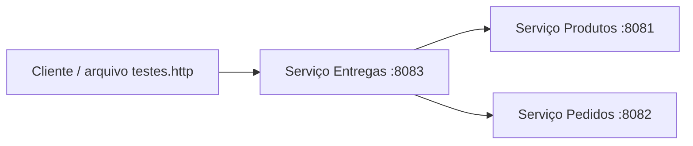

# Tarefa Microserviços

**Integrantes da dupla:** Enzo Maceira e Karen

## 1. Objetivo
Projeto didático com três serviços REST independentes: Produtos, Pedidos e Entregas.
O serviço Entregas consulta Produtos e Pedidos por HTTP antes de cadastrar uma entrega.

## 2. Tecnologias
- Java 17
- Spring Boot 3.3.5
- Maven
- IntelliJ IDEA
- Testes com JUnit e Spring Boot Test

## 3. Arquitetura

Produtos e Pedidos disponibilizam dados para consulta. Entregas usa esses serviços para validar o produto e o pedido informado.

## 4. Como executar no IntelliJ
É necessário ter JDK 17 instalado.

1. Abra a pasta `produtos` no IntelliJ e execute a classe `ProdutosApplication`. O serviço ficará na porta 8081.
2. Abra a pasta `pedidos` em outra janela do IntelliJ e execute `PedidosApplication`. O serviço ficará na porta 8082.
3. Abra a pasta `entregas` em outra janela e execute `EntregasApplication`. O serviço ficará na porta 8083.
4. Abra `testes.http` e execute as requisições na ordem em que aparecem.

Também é possível executar cada serviço pelo terminal, dentro de sua pasta, se o Maven estiver instalado: `mvn spring-boot:run`.

## 5. Endpoints
- Produtos: `GET http://localhost:8081/produtos` e `GET http://localhost:8081/produtos/1`
- Pedidos: `GET http://localhost:8082/pedidos` e `GET http://localhost:8082/pedidos/100`
- Entregas: `GET http://localhost:8083/entregas`, `GET http://localhost:8083/entregas/1` e `POST http://localhost:8083/entregas`

## 6. Matriz de testes

| ID | Cenário | Requisição/ação | Resultado esperado | Resultado obtido |
|---|---|---|---|---|
| T01 | Listar produtos | GET /produtos | HTTP 200 e lista de produtos | Preencher após executar |
| T02 | Consultar produto existente | GET /produtos/1 | HTTP 200 e dados do produto | Preencher após executar |
| T03 | Consultar pedido existente | GET /pedidos/100 | HTTP 200 e dados do pedido | Preencher após executar |
| T04 | Criar entrega válida | POST /entregas com pedido 100 e produto 1 | HTTP 201 e entrega cadastrada | Preencher após executar |
| T05 | Criar entrega com produto inexistente | POST /entregas com produto 999 | HTTP 400 com mensagem de erro | Preencher após executar |
| T06 | Listar entregas | GET /entregas | HTTP 200 e lista de entregas | Preencher após executar |
| T07 | Consultar entrega inexistente | GET /entregas/999 | HTTP 404 | Preencher após executar |

## 7. Evidências
Depois de executar os testes no IntelliJ, adicionar nesta seção capturas de tela mostrando:
- os três serviços iniciados;
- uma resposta de sucesso;
- uma resposta de erro esperada;
- os testes executados.

**Importante:** não invente resultados. Preencha a coluna “Resultado obtido” e adicione as capturas somente depois de executar os testes.

## 8. Participação da dupla
- Enzo Maceira: descrever as atividades realizadas.
- Karen: descrever as atividades realizadas.

Cada integrante deve realizar commits identificáveis no GitHub e explicar sua participação.
